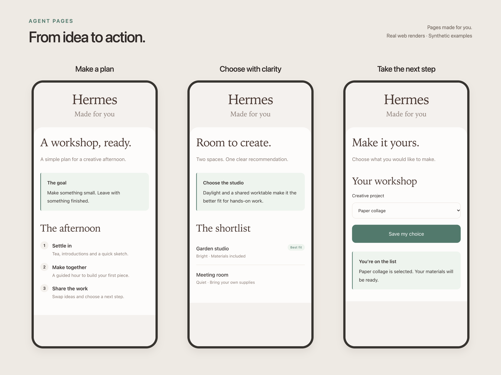

# Agent Pages

Interactive Pages authored by AI agents, viewed on the web, with an iMessage companion and a self-hosted library server. Start with the synthetic form below; its input and result run entirely in the browser.


*Real web renderer at iPhone dimensions; synthetic examples, not native Messages captures. [Reproduce the showcase](examples/showcase/README.md).*

The web renderer and Python server work independently of an agent framework. Hermes has an extracted delivery adapter with mocked transport tests. The iOS host, Messages and Quick Look extensions have Simulator build support; native live delivery is unverified. OpenClaw is planned only.

## Quickstart

Use Node 22+, Python 3.9+, and Chrome for the browser test (`CHROME_PATH` can select its executable). Run from the repository root:

```sh
git clone git@github.com:perryraskin/agent-pages.git
cd agent-pages
npm ci --ignore-scripts
npm run build
npm test
npm run test:form
```

Open `apps/web/build/form.html` in a browser. The build renders and hydrates [the sample Page](examples/form/page.tsx); the form has no server storage. Build output is not published automatically.

For the library and snapshot APIs, run in a separate terminal:

```sh
python3 server/server.py \
  --root apps/web \
  --state .state \
  --private-port 19133 \
  --public-port 19134
```

```sh
curl --fail http://127.0.0.1:19133/health
curl --fail http://127.0.0.1:19133/v1/pages
```

The server does not serve the demo at `/` or `/form.html`. The private listener exposes library APIs; the public listener serves token snapshots. See [self hosting](docs/self-host.md) before configuring HTTPS or remote access.

## Author, render and deliver

Edit [examples/form/page.tsx](examples/form/page.tsx), a default-exported React component importing `Page` from `grok/canvas`, then run `npm run build` again. The [build script](apps/web/scripts/build.mjs) currently targets this example explicitly; it is not a general Page discovery CLI. It writes `build/form.html` and copies [metadata](examples/form/meta.json) into `apps/web/src/form/meta.json`.

The [canvas implementation](packages/renderer/canvas.tsx) defines available components; [JSON surfaces](packages/renderer/json-surface.tsx) and [A2UI](packages/renderer/a2ui.tsx) are other renderer entrypoints. Read their actual interfaces before generating content. The [reference protocol](packages/protocol/index.mjs) uses version `2`, `pageID` and `html`; the delivery exporter also includes `title`.

Export the built example locally without sending a message:

```sh
python3 server/send_page.py form --output demo.hermespage
python3 server/send_page.py --help
```

See the [Hermes adapter](adapters/hermes/README.md) for configuration and explicit send options. Live delivery requires an operator-configured bridge and signed native helper; do not use real recipients for onboarding tests. [OpenClaw](adapters/openclaw/README.md) is a roadmap entry, not an implemented integration. [iCloud publishing](adapters/icloud/publish.py) is optional and explicitly configured.

## Find the right code

| Task | Entry point |
| --- | --- |
| Author or change components | [Example](examples/form/page.tsx), [renderer](packages/renderer) |
| Integrate references | [Protocol](packages/protocol/index.mjs), [protocol test](tests/protocol.test.mjs) |
| Library, tags, shares and snapshots | [Server](server/server.py), [server tests](server/tests) |
| Deliver or inspect native support | [Exporter](server/send_page.py), [native helper](server/native), [iOS app](apps/ios) |
| Deploy or review constraints | [Self hosting](docs/self-host.md), [security](docs/security.md), [attribution](docs/attribution.md) |

## iOS and validation

For optional Simulator compilation, use macOS, Xcode 16+, XcodeGen and an iOS 18+ SDK:

```sh
xcodegen generate --spec apps/ios/project.yml
xcodebuild \
  -project apps/ios/HermesPages.xcodeproj \
  -scheme HermesPages \
  -sdk iphonesimulator \
  -configuration Debug \
  CODE_SIGNING_ALLOWED=NO build
```

Signing fields are blank. See [Signing.xcconfig.example](apps/ios/Signing.xcconfig.example) for your own device settings. Existing Hermes document identifiers remain for wire compatibility. Compilation does not establish physical-device delivery support.

`npm test` runs protocol and Python server tests; `npm run test:form` checks the browser interaction. [CI](.github/workflows/ci.yml) also runs native-delivery Python tests on macOS; those are not live iMessage delivery tests.

## Safety and licensing

Build trusted Page source only: rendering executes JavaScript on the host. The private API has no application authentication; protect it with loopback or explicit tailnet access controls. Never expose it publicly, upload `.state`, credentials, private libraries or logs, or alter live accounts and security settings during demo work. Shared snapshots are bearer links. Read [security constraints](docs/security.md) before delivery or deployment.

No blanket license is granted: neither original source has a root license or package license field. Permission to redistribute or reuse first-party code must be resolved with its rights holders. Third-party font and dependency licenses remain applicable; see [attribution](docs/attribution.md).
